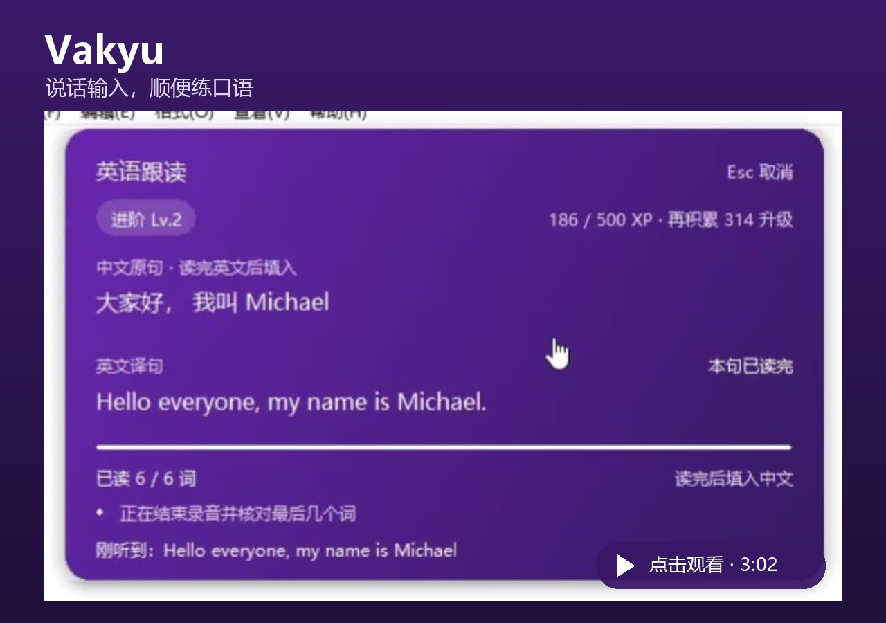

  

# Vakyu Voice Input

**Offline dictation, a Chinese IME, and optional English/Chinese reading practice for Windows and macOS (Apple Silicon).**

[中文](README.md) · [Windows download](https://github.com/chenjunqi06-glitch/vakyu-voice-input/releases/tag/v0.1.5-preview.3) · [Mac download](https://github.com/chenjunqi06-glitch/vakyu-voice-input/releases/tag/macos-build9-20261013) · [User guide (Chinese)](docs/user/getting-started/vakyu-quickstart.md) · [Issues](https://github.com/chenjunqi06-glitch/vakyu-voice-input/issues)

Vakyu combines push-to-talk speech-to-text with language practice based on what you actually want to say. Speech recognition runs locally on the CPU. No GPU or API key is needed for ordinary dictation; optional sentence translation uses your own OpenAI-compatible API provider.

> **Latest Windows preview: [0.1.5 Preview 3](https://github.com/chenjunqi06-glitch/vakyu-voice-input/releases/tag/v0.1.5-preview.3)** · Improved voice triggers, shortcut saving, and background stability, with an updated full Windows installer.

> **Mac preview released: [Apple Silicon build 9](https://github.com/chenjunqi06-glitch/vakyu-voice-input/releases/tag/macos-build9-20261013) (2026-10-13)** · Requires macOS 13 or later. Includes a [PKG installer](https://github.com/chenjunqi06-glitch/vakyu-voice-input/releases/download/macos-build9-20261013/vakyu-macos-arm64-build9.pkg) and [corresponding source](https://github.com/chenjunqi06-glitch/vakyu-voice-input/tree/macos-build9). A user has confirmed voice insertion in TextEdit, Safari, and WeChat without automatic sending.

## Video demo

[Watch or download the full demo](https://github.com/chenjunqi06-glitch/vakyu-voice-input/releases/download/v0.1.5-preview.3/vakyu-voice-input-demo.mp4) · Chinese narration · 3:02 · MP4, about 78 MB. Click the cover to open the video; your browser may download it instead.

## What makes it useful

- Hold **Left Alt on Windows** or **Left Option on Mac** to dictate Chinese into an editable text field. Release to insert the result. It never presses Send.
- Enable reading practice, hold **Right Ctrl + Right Alt on Windows** (your configured practice shortcut on Mac) to record your original message, then read its translation. Your original message is inserted after completion.
- Practise either direction: Chinese → English, or English → Chinese with pinyin hints.
- Keep words you have already passed. Continue after a pause or mistake, retry, skip a word, approve it manually, or explicitly restart the whole sentence.
- Click words for a local dictionary card and system text-to-speech. Coverage varies; missing definitions are not invented.
- Use Chinese pinyin input, local frequency learning, configurable shortcuts, tray controls, and a purple interface.

Matching uses speech recognition and text similarity. This is a practice aid, not a certified pronunciation assessment.

## Install and start

The preview uses a fixed demonstration sentence, not a private conversation.

### Windows

The current **Windows preview** targets Windows 10 22H2 (19045) / Windows 11 on Intel or AMD **x64**. Download the `windows-x86_64-setup.exe` asset from [Releases](https://github.com/chenjunqi06-glitch/vakyu-voice-input/releases), run it, and follow the installer. Python, speech models, dictionaries, and required runtimes are included.

Open **Vakyu 设置** from Start or the notification-area icon. Allow desktop microphone access in Windows and wait for the local model to become ready. Click a normal text field, hold Left Alt, speak, and release. Use `Win + Space` to select Vakyu for pinyin typing; the global voice feature does not require changing the current input method.

Public builds are not yet signed by a trusted publisher and may trigger Windows security prompts. Verify the Release source and supplied SHA-256 checksums. Clean-machine installation and uninstallation have not yet been fully validated.

### macOS (Apple Silicon)

**Mac build 9 is available as a preview** for Apple Silicon (M-series) Macs running macOS 13 or later. No Intel Mac installer is currently provided.

1. Download [vakyu-macos-arm64-build9.pkg](https://github.com/chenjunqi06-glitch/vakyu-voice-input/releases/download/macos-build9-20261013/vakyu-macos-arm64-build9.pkg). The [release page](https://github.com/chenjunqi06-glitch/vakyu-voice-input/releases/tag/macos-build9-20261013) also includes the full source archive and `SHA256SUMS`.
2. Run the installer, add Vakyu in **System Settings → Keyboard → Input Sources**, and follow Vakyu voice settings to grant the required microphone and Accessibility permissions.
3. Focus an editable text field, hold **Left Option**, speak, and release to insert the result. Use the practice shortcut saved in voice settings for reading practice. Vakyu does not press Send.

This build improves voice startup and insertion when an editor cannot be read, with an optional restricted paste fallback and stale-permission guidance. A user has confirmed voice insertion in TextEdit, Safari, and WeChat; this does not establish compatibility with every app or a clean Mac installation.

The preview is not Apple Developer ID signed or notarized, and updates may require re-adding system permissions. The PKG stops if it detects an existing user-level Vakyu installation; review the [release notes](https://github.com/chenjunqi06-glitch/vakyu-voice-input/releases/tag/macos-build9-20261013) before installing to avoid duplicate input methods. Corresponding source is on the separate [macos-build9 branch](https://github.com/chenjunqi06-glitch/vakyu-voice-input/tree/macos-build9).

## Optional reading practice

The shortcut names and settings steps below describe Windows. On Mac, ordinary dictation uses Left Option and reading practice uses the shortcut saved in voice settings.

1. In **云服务** (Cloud services), enter your own endpoint, model, and API key; select **测试连接** (Test connection). You may keep **启用云联想** (Cloud suggestions) off.
2. In **快捷键** (Shortcuts), enable **启用跟读练习 / Reading practice**. It is off by default.
3. **学习英语 / Learn English** on: speak Chinese, read English, insert your original Chinese. Turn it off: speak English, read Chinese, insert your original English.
4. Hold Right Ctrl + Right Alt to record the source message. Release, listen to the optional local demonstration, and read the translation when the microphone starts.
5. Passed words remain highlighted. Complete the sentence to insert the original message, or press `Esc` to cancel. Sending remains your decision.

Left Alt dictation stays independent even when practice is enabled. Shortcuts can be changed in settings; system-registered conflicts are checked, but application-local shortcuts and low-level keyboard hooks cannot all be detected.

## Privacy, costs, and limitations

Local speech recognition does not upload or save microphone recordings. Dictionary lookup, practice recognition, and demonstration playback do not consume API tokens. Sentence translation sends the current source text directly to your chosen provider and is billed by that provider. Optional cloud suggestions send pinyin and nearby text when enabled; they are off by default. Local typing logs and personal dictionaries can contain private text. Do not attach keys or unreviewed logs to issues.

Ordinary editable fields are the primary target. Password fields, secure desktops, elevated applications, games, and some custom controls may not work. Only one interactive Windows session is supported. Windows ARM and 32-bit Windows are unsupported by this installer.

The [Apple Silicon macOS build 9 preview](https://github.com/chenjunqi06-glitch/vakyu-voice-input/releases/tag/macos-build9-20261013) includes an installer and source, with the validation scope described above. This repository's input method has no iOS version. The inherited Linux input-method code does not imply that Vakyu's voice features work on Linux.

## About the Vakyu team

We build proactive, interactive AI language-learning experiences that bring practice into everyday communication.

Our mobile product, **Vakyu AI language learning**, is available on Google Play, with its Apple App Store submission under review. This repository maintains the open-source **Vakyu Voice Input** project; its supported platforms and installation instructions are documented above. The mobile product's store availability does not mean this repository offers a mobile keyboard package.

Website: [vakyu.com](https://vakyu.com) · Business inquiries on WeChat: **cyx121a**

## Source and license

Vakyu is an independent project that continues development from [Qingjian](https://github.com/qingjian-team/qingjian). Thanks to Qingjian's original author and principal maintainer [@yenharvey](https://github.com/yenharvey), qingjian-team, and [all contributors](https://github.com/qingjian-team/qingjian/graphs/contributors) for the input-method foundation. It is not an official Qingjian release, and attribution does not imply upstream endorsement or warranty. Some internal names and compatibility paths remain unchanged to preserve upgrades and user data. See [UPSTREAM.md](UPSTREAM.md) for the source snapshot and modification record.

Project code is licensed under **[GPL-3.0-or-later](LICENSE)**. Preserve copyright notices and meet the corresponding-source requirements when distributing modifications or binaries. Releases include corresponding source archives. Third-party libraries, runtimes, speech models, and dictionaries have their own licenses; see the installer’s `licenses` directory and [data sources](docs/design/landscape.md).

See [contributing](docs/contributing.md), [Windows packaging](apps/windows/installer/README.md), and [developer documentation](docs/README.md). Please include the application version, operating-system version, target application, and reproduction steps when filing an issue.
