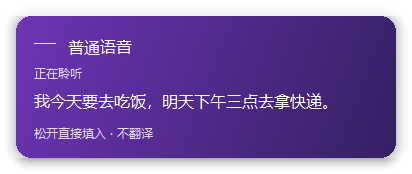
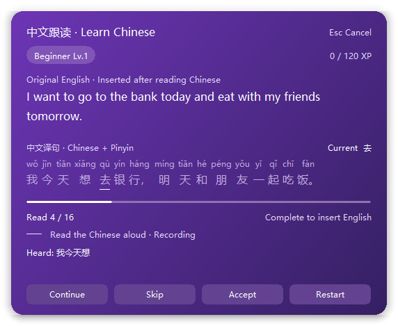

  

# Vakyu Voice Input · 语音输入法与中英口语跟读

**按住说话，松开输入；把每天想说的话，变成自己的口语练习。**

Vakyu 是面向 Windows 的开源中文输入法，集成本地语音转文字、双向中英跟读、离线词典和个人词频学习。普通语音在本机 CPU 上识别，不需要显卡、API 密钥或云端语音额度；可选的口语跟读使用你自己的翻译 API。

**项目来源：** Vakyu 是在 [Qingjian / 青简](https://github.com/qingjian-team/qingjian) 基础上继续迭代的独立开源项目。感谢青简原作者及主要维护者 [@yenharvey](https://github.com/yenharvey) 和[所有贡献者](https://github.com/qingjian-team/qingjian/graphs/contributors)打下的输入法基础。代码沿用 GPL-3.0-or-later，来源版本与修改说明见 [UPSTREAM.md](UPSTREAM.md)。

Open-source Windows Chinese IME with offline speech-to-text, push-to-talk dictation, and optional English/Chinese reading practice. [English](README.en.md)

[下载安装包](https://github.com/chenjunqi06-glitch/vakyu-voice-input/releases) · [详细使用教程](docs/user/getting-started/vakyu-quickstart.md) · [反馈问题](https://github.com/chenjunqi06-glitch/vakyu-voice-input/issues) · [GPL-3.0-or-later](LICENSE)

## 有什么亮点

- **按住左 Alt 就能说**：在文本框中口述，实时预览识别文字与麦克风音量，松开后填入原输入框。支持连续口述与中途停顿，不设五分钟自动截止，也不会自动发送消息。
- **用自己的话练口语**：说中文、跟读英文；切换方向后，说英文、跟读中文。完成练习才填入原话，练习是自愿开启的独立功能。
- **读错了不用整句重来**：已通过的词逐个着色并保留进度，可继续补读、跳过当前词或手动点「我读对了」，也能主动整句重读。
- **适合逐步练习**：文字匹配容错、专名处理、本机示范朗读和经验等级。它帮助练习朗读，不是专业发音评分或考试系统。
- **点词就能查**：本地词卡显示英文词的中文释义与可用音标，或中文词的拼音与英文释义；使用系统声音播放，不额外调用翻译 API。生僻词覆盖以随包词典为准。
- **输入与学习一起用**：拼音候选、整句输入、词频学习与候选译词，配合紫色主题、可配置快捷键及托盘快捷开关。
- **费用可控**：云联想默认关闭；普通拼音和普通语音不消耗 API token。只开跟读时，云端用于本轮文字翻译；同轮补读、查词和示范朗读在本地完成。

  
  

以上为程序渲染的示例界面，使用固定演示句子，没有真实聊天内容。

## 下载与安装

当前提供 **Windows 测试版**：Windows 10 22H2（19045）或 Windows 11，Intel / AMD **x64** 电脑。

1. 打开本仓库的 [Releases](https://github.com/chenjunqi06-glitch/vakyu-voice-input/releases)，在 Assets 下载以 `windows-x86_64-setup.exe` 结尾的文件。GitHub 自动生成的 `Source code` 是源码，不是安装包。
2. 运行安装包，按提示授权管理员权限并安装。安装包包含语音模型、词典和所需运行库，不用另装 Python、Rust 或开发工具。
3. 从开始菜单打开「Vakyu 设置」，或右击任务栏右下角的 Vakyu 图标进入设置。
4. 要使用拼音输入，按 `Win + Space` 选择 Vakyu；独立语音入口只需后台运行，无需先切换输入法。

首次启动需等待本地语音模型就绪，并在 Windows 中允许桌面应用使用麦克风。当前公开安装包尚无可信的发布者代码签名，可能出现 Windows 安全提示；请核对 Release 来源及随附 SHA-256。不要关闭系统安全功能。

## 两种用法，一张表看懂

| 模式 | 默认操作 | 结果 | 是否需要 API |
|---|---|---|---|
| 普通语音输入 | 点文本框，按住 **左 Alt** 说中文，松开 | 直接填入识别文字 | 不需要 |
| 学英语 | 开启跟读，按住 **右 Ctrl + 右 Alt** 说中文，松开后读英文译句 | 完成后填入原中文 | 需要翻译 API |
| 学中文 | 关闭「学习英语」方向开关，按住 **右 Ctrl + 右 Alt** 说英文，松开后读中文译句 | 完成后填入原英文 | 需要翻译 API |

以上均**只填入，不自动按发送键**。`Esc` 取消当前录音或练习。普通语音键与跟读键相互独立，开启跟读后左 Alt 仍直接输入。

跟读默认关闭。在「设置 → 云服务」填写自己的服务地址、模型和 API 密钥，点「测试连接」；然后在「设置 → 快捷键」开启「启用跟读练习 / Reading practice」。「学习英语 / Learn English」控制学习方向，关闭它表示学中文。**无需开启「启用云联想」也能使用跟读翻译**。

完整操作、DeepSeek 配置示例、快捷键冲突说明和排障见 [Vakyu 快速上手](docs/user/getting-started/vakyu-quickstart.md)。

## 平台与兼容性

| 平台 | 当前状态 |
|---|---|
| Windows 10 22H2 / Windows 11，原生 x64 | 提供测试版安装包；尚未完成全新 Windows 环境的完整安装与卸载验收 |
| Windows ARM / 32 位 Windows | 此安装包不支持 |
| macOS，Apple Silicon | [移植源码](apps/macos/README.md)已在仓库中，仍需 Mac 编译与真机验收，当前没有经过验证的等效安装版 |
| iOS | 暂无版本 |
| Linux | 保留上游 Fcitx5 输入法代码；本项目新增语音与跟读功能未在 Linux 上验证 |

普通权限的常见可编辑文本框是主要场景。密码框、系统安全界面、管理员权限程序、游戏及部分自绘控件可能不支持，不能保证所有软件都能填入。当前仅支持单个交互登录会话，不适用于多个 Windows 用户同时运行。更新输入法基础组件后，已加载旧组件的应用可能需要重开。

## 隐私与费用

| 功能 | 数据在哪里处理 | 费用 |
|---|---|---|
| 拼音、词频学习、普通语音识别 | 本机；语音功能不上传或保存录音文件 | 无 API 费用 |
| 跟读识别、词卡、示范朗读 | 本机 | 无 API 费用 |
| 跟读句子翻译 | 本轮原文直接发送给你配置的 API 服务商，不经过项目作者的服务器 | 按服务商用量计费 |
| 可选云联想 | 开启后发送拼音、候选与光标附近文字给该服务商 | 按服务商用量计费 |

安装包不包含作者密钥或公共免费额度。API 密钥保存在本机；不要提交到 GitHub。输入日志与个人词库也是本地数据，可在设置中管理；提交问题前请检查日志和截图，移除私人文本及密钥。关闭云联想可以避免日常打字触发云端请求，不会关闭独立跟读翻译。

## 开发与参与

- [开发文档](docs/README.md)与[开发约定](docs/contributing.md)
- [Windows 安装包构建与校验](apps/windows/installer/README.md)
- [Windows 平台开发](apps/windows/README.md)
- [macOS 移植与构建](apps/macos/README.md)
- [可选 GitHub Actions 工作流示例](docs/github-workflows/README.md)（当前未启用自动 CI）

欢迎提交兼容性反馈、识别例子和改进。报错时请注明 Vakyu 版本、Windows 版本、目标软件及复现步骤。语音准确度与麦克风、环境、口音有关，不承诺零误识别。旧工程文档部分仍使用 Qingjian / Miracle 名称，Vakyu 的当前使用方式以本页和快速上手为准。

## 来源与许可

Vakyu 基于 [Qingjian / 青简](https://github.com/qingjian-team/qingjian) 发展，感谢原作者及主要维护者 [@yenharvey](https://github.com/yenharvey)、qingjian-team 与[所有贡献者](https://github.com/qingjian-team/qingjian/graphs/contributors)。Vakyu 是独立衍生项目，不是青简官方发行版；这些署名不表示上游认可或担保 Vakyu。上游网站提供的安装包也不是本项目安装包。详见[上游与许可说明](UPSTREAM.md)。

项目代码采用 **[GNU GPL-3.0-or-later](LICENSE)**。修改和再分发时需履行 GPL 义务，并保留原作者版权及许可声明。每个 Release 提供对应源码包；第三方程序、运行库、词典与语音模型适用各自许可，详见[数据来源](docs/design/landscape.md)和安装包中的 `licenses`。部分内部目录、包名及兼容路径继续沿用 Qingjian，避免破坏升级和现有用户数据。
